# PROJECT_SPEC.md — Unified AI Workspace (working title: "AI Manager")

> **Status:** Draft v0.1 — specification only. No application code exists yet.
> **Date:** 2026-11-15
> **Legend used throughout**
>
> | Tag | Meaning |
> |---|---|
> | **[MVP]** | Required for the first usable release (Phases 1–3 core) |
> | **[LATER]** | Planned, but after MVP is validated |
> | **[OPTIONAL]** | Architectural consideration; adopt only if justified |
> | **[OPEN]** | Unresolved decision; a provisional assumption is stated and listed in §20 |
> | **[ASSUMPTION]** | Provisional assumption made because information was missing |

---

## Table of Contents

1. Executive Summary
2. Problem Statement
3. Product Vision and Positioning
4. Target Users and Use Cases
5. Core Functional Requirements
6. Detailed Module Specifications
7. User Experience and Information Architecture
8. System Architecture
9. Technology Stack and Justifications
10. Database Schema Proposal
11. API and Service Design
12. AI and Knowledge Processing Architecture
13. Chrome Extension Architecture
14. Privacy and Security
15. Competitor Landscape and Differentiation
16. Development Roadmap
17. MVP Scope and Acceptance Criteria
18. Technical Risks and Constraints
19. Future Possibilities
20. Open Architectural Decisions

---

## 1. Executive Summary

People now use several AI assistants (ChatGPT, Claude, Gemini, Perplexity, …), often with multiple accounts per provider. Their conversations — and the knowledge inside them — are scattered across silos with no shared search, organization, or synthesis.

**AI Manager** is a personal knowledge-management layer for a user's AI interactions. It consists of:

- A **Chrome extension (MV3)** that captures conversations from supported AI sites and offers quick categorization and search.
- A **web application** (primary interface) with a unified conversation dashboard, organization tools (categories, tags, projects, folders, bookmarks), a knowledge workspace, and a multi-model comparison workspace.
- A **backend** (Node.js/TypeScript + PostgreSQL/pgvector) that normalizes provider-specific data into one schema, indexes at message level, and produces *source-attributed* knowledge synthesis.

Four modules:

| Module | Summary | Phase |
|---|---|---|
| A. Unified Conversation History | Multi-provider, multi-account store with capture, import, search | 1 |
| B. Intelligent Organization | AI-suggested categories/tags/projects with user confirmation | 2 |
| C. Personal Knowledge Layer | Persistent, provenance-linked topic knowledge across conversations | 3 (MVP-lite), 5 (advanced) |
| D. Multi-Model Workspace | BYOK parallel prompting and side-by-side comparison | 4 |

**Key architectural stance:**

1. Ingestion is *modular and provider-specific*; storage is *provider-independent*.
2. Knowledge is stored as **first-class, citation-backed records** (topics, claims/insights) that are separate from raw conversations, not just a RAG chat over chunks.
3. Start as a **modular monolith** (one Node service + Postgres). No microservices, no graph database, no Python service in the MVP.
4. Privacy is foundational: per-user isolation, encrypted secrets, explicit disclosure on any third-party LLM/embedding call, full export/deletion.
5. The MVP validates the loop **capture → find → organize → synthesize with citations**. Multi-model comparison and graph intelligence follow.

---

## 2. Problem Statement

| # | Problem | Consequence |
|---|---|---|
| P1 | Conversations are split across providers and accounts | Users forget where a discussion lives |
| P2 | Each provider has its own (weak or absent) search | Finding old content means manual searching in N places |
| P3 | Insights are trapped in long chat threads | Knowledge is not reusable; same questions get re-asked |
| P4 | Related discussions across providers are not linked | No consolidated understanding of a topic |
| P5 | Comparing models requires copy-pasting a prompt across tabs | Slow, inconsistent, no record of comparison |
| P6 | Provider exports/APIs are inconsistent or unavailable | No universal way to get history |

---

## 3. Product Vision and Positioning

**Vision:** the user's *second brain for AI interactions* — every conversation they've had with any AI becomes searchable, organized, and distilled into durable, traceable knowledge.

**Positioning:** not "a search box over old chats" but a **knowledge layer** with three differentiating principles:

1. **Provenance-first:** every synthesized statement links to source message(s).
2. **User-controlled:** AI suggests; the user decides (categories, tags, projects, knowledge edits).
3. **Project-centric:** knowledge is organized around what the user is *doing* (projects), not only what was *said*.

**Non-goals (initially):**
- Replacing the AI providers' own chat UIs.
- Proxying or automating the user's logged-in sessions on AI sites.
- Collecting provider credentials (never).
- Real-time team collaboration. **[LATER/OPTIONAL]**
- Mobile apps. **[LATER]**

---

## 4. Target Users and Use Cases

### 4.1 Personas

| Persona | Description | Primary needs |
|---|---|---|
| **Student/Researcher** | Uses ChatGPT (personal + college account), Claude, Gemini for study and research | Find old explanations; consolidate research on a topic |
| **Developer/Indie hacker** | Uses multiple AIs for code, architecture, startup ideas | Recover code discussions; compare model answers; project notes |
| **Knowledge worker / Founder** | Separate work/personal accounts | Cross-account search; collect all approaches considered for a decision |

### 4.2 Use cases

| ID | Use case | Module |
|---|---|---|
| UC1 | "Where did I discuss domain randomization?" (find across providers/accounts) | A |
| UC2 | Import ChatGPT/Claude data export for historical backfill | A |
| UC3 | Review newly captured chats; accept suggested category/tags/project in one click | B |
| UC4 | "Collate everything I've discussed about RL environments" with citations | C |
| UC5 | See that two chats recommend conflicting approaches | C |
| UC6 | Send one prompt to GPT, Claude, Gemini; compare; save best answer as an insight | D |
| UC7 | Export or delete all my data | Cross-cutting |

---

## 5. Core Functional Requirements

Consolidated list with IDs (details in §6).

### Module A — Unified History
| ID | Requirement | Tag |
|---|---|---|
| A1 | Provider registry (ChatGPT, Claude, Gemini, Perplexity first; extensible) | MVP (2–3 providers), rest LATER |
| A2 | Multiple accounts per provider with user-defined labels | MVP |
| A3 | Normalized conversation/message storage with metadata, URL, timestamps | MVP |
| A4 | Dashboard: browse, filter (provider/account/date/category), search, view detail, open original | MVP |
| A5 | Incremental capture (no full re-import each time) | MVP |
| A6 | Historical import via user-uploaded exports | MVP (≥1–2 providers) |
| A7 | Attachment metadata (filenames, types); blob storage of content | Metadata MVP; blobs LATER |
| A8 | Official-API ingestion where available | OPTIONAL |

### Module B — Organization
| ID | Requirement | Tag |
|---|---|---|
| B1 | AI category suggestion on new conversation | MVP (Phase 2) |
| B2 | Confirmation workflow (accept/change/manual/skip/new category) | MVP (Phase 2) |
| B3 | Custom categories, tags, projects, folders, bookmarks | Categories/tags/projects/bookmarks MVP; folders LATER |
| B4 | Many-to-many tags and projects; single primary category | MVP |
| B5 | Learn from feedback (few-shot examples, per-user) | MVP-lite (few-shot); embedding classifier LATER |

### Module C — Knowledge Layer
| ID | Requirement | Tag |
|---|---|---|
| C1 | Message-level indexing; hybrid search (FTS + vector) | MVP |
| C2 | Cross-conversation retrieval across providers | MVP |
| C3 | On-demand synthesis with mandatory citations | MVP |
| C4 | Persistent topic pages (summary + cited insights), incremental update | MVP-lite |
| C5 | Surface disagreement/uncertainty | MVP-lite (prompted + flagged); automated detection LATER |
| C6 | Manual curation: save insight, edit, pin, dismiss, link to project | MVP |
| C7 | Entity/concept extraction, topic clustering | LATER (light version OPTIONAL in MVP) |
| C8 | Knowledge graph structures, evolution timeline, unresolved questions | LATER (Phase 5) |
| C9 | MCP server for external AI clients | LATER (Phase 5) |

### Module D — Multi-Model Workspace
| ID | Requirement | Tag |
|---|---|---|
| D1 | Unified prompt input, multi-model select | MVP (Phase 4) |
| D2 | Parallel execution via official APIs, BYOK | MVP (Phase 4) |
| D3 | Side-by-side responses with latency, tokens, estimated cost | MVP (Phase 4) |
| D4 | Copy, save comparison, save response to knowledge | MVP (Phase 4) |
| D5 | Continue chat with single model | LATER (Phase 4+) |
| D6 | Provider-adapter architecture | MVP |

### Cross-cutting
| ID | Requirement | Tag |
|---|---|---|
| X1 | Auth, per-user isolation | MVP |
| X2 | Data export and deletion | MVP |
| X3 | Encrypted API-key storage | MVP |
| X4 | Disclosure and consent before sending content to third-party LLMs | MVP |
| X5 | Local-first / offline sync | OPTIONAL (see §20) |

---

## 6. Detailed Module Specifications

### 6.1 Module A — Unified AI Conversation History

#### 6.1.1 Ingestion methods

There is **no universal reliable API** for conversation history. We therefore define an `Ingestor` abstraction with several concrete sources:

| Method | Mechanism | Strengths | Weaknesses | Tag |
|---|---|---|---|---|
| **Extension capture** | Provider-specific content script reads rendered conversation DOM (or observes the page's own network responses — see §13.4) | Works for any provider with a web UI; incremental; reflects what user actually sees | Fragile to UI changes; virtualized lists; may conflict with provider ToS (see §18); account detection is heuristic | MVP |
| **Export import** | User uploads official data-export (e.g., ZIP/JSON) | Complete history; stable-ish formats; no scraping | Manual; formats change; not all providers offer it; point-in-time | MVP |
| **Official API** | Provider API | Stable | Most consumer-chat histories are *not* exposed through developer APIs | OPTIONAL |
| **Manual paste / share-link import** | User pastes text or a shared link's content | Universal fallback | Low fidelity | LATER |
| **Module D saves** | Conversations created inside the app's own workspace | First-party, perfect fidelity | Only covers app-originated chats | Phase 4 |

**[ASSUMPTION]** Initial providers for MVP: **ChatGPT and Claude** (largest user bases and known export mechanisms); Gemini and Perplexity in Phase 1.5/2. Export format specifics must be verified against current provider exports at implementation time — formats are not guaranteed stable and are not documented here as fact.

#### 6.1.2 Provider adapter contract (conceptual)

```ts
// Conceptual interface — NOT implementation code
interface ProviderIngestAdapter {
  providerId: string;                         // "chatgpt" | "claude" | ...
  // Extension side
  matchesUrl(url: URL): boolean;
  detectAccount(doc: Document): AccountHint | null;
  extractConversation(doc: Document): RawCapture | null;
  observeChanges(doc: Document, cb: (c: RawCapture) => void): Unsubscribe;
  // Backend side
  normalize(raw: RawCapture): NormalizedConversation;
  parseExport?(file: File | Buffer): AsyncIterable<NormalizedConversation>;
}
```

Adding a provider = adding one extension adapter + one backend normalizer (+ optional export parser). No changes to schema, search, or UI.

#### 6.1.3 Normalization rules

- Every conversation gets `(provider_account_id, external_id)` unique key → idempotent upserts.
- Messages get `(conversation_id, ordinal)` and a `content_hash` for change detection.
- Preserve provider-specific oddities in `raw_metadata JSONB`, never in core columns.
- Message content stored as **structured parts** (text, code, image-ref, tool-call, citation) in `content_parts JSONB` plus a derived plain-text `content_text` used for FTS/embeddings.
- Roles normalized to `user | assistant | system | tool`.

#### 6.1.3a Incremental updates

1. Extension keeps a local `(external_id → last content_hash, last message count)` map in IndexedDB.
2. On change (debounced, e.g., after streaming completes), it sends only conversations whose hash changed; backend upserts by `external_id`, appends new messages, and updates edited ones (hash mismatch → new `message_revision` or in-place update; **[OPEN]** revision retention).
3. Backend returns `{conversation_id, new_message_ids}`, which triggers downstream indexing jobs for only new/changed messages.

#### 6.1.4 Dashboard

- Table/list with provider icon, account label, title, last-updated, category chip, tags, project.
- Filters: provider, account, date range, category, tag, project, bookmarked, "needs review".
- Search: keyword (FTS) in MVP phase 1; hybrid in Phase 3.
- Detail view: rendered messages, per-message permalink anchor, "Open original" button (stored URL), metadata panel.

### 6.2 Module B — Intelligent Organization

**Entities:** Category (single primary per conversation), Tag (many), Project (many), Folder **[LATER]**, Bookmark flag.

**Suggestion flow**

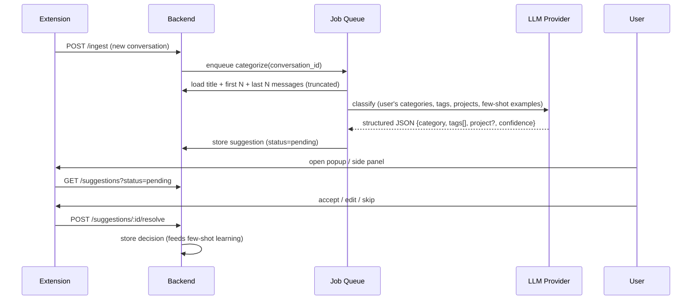

**Rules**
- Suggestions never auto-apply by default. **[OPEN]** Optional "auto-apply above confidence X" setting **[LATER]**.
- Suggestion stored separately from the applied assignment (`categorization_suggestions` vs. assignments) so rejections are learnable signal.
- Only a **bounded excerpt** (title + first/last messages, token-capped) is sent to the LLM by default, to limit data exposure (§14).
- **Learning from feedback (MVP-lite):** include the user's most recent *k* accepted/corrected examples (and nearest-neighbor examples by embedding in Phase 3) as few-shot context. No model fine-tuning.
- Categories are per-user; a default starter set (Academics, Programming, Research, Startup, Personal, Finance, Miscellaneous) is seeded and editable/deletable.
- Review queue UX: batch review with keyboard shortcuts ("Enter to accept", "Tab to edit").

### 6.3 Module C — Personal AI Knowledge Layer

#### 6.3.1 Core idea: knowledge as its own layer

Three tiers of data, with strict separation:

| Tier | What | Mutability | Provenance |
|---|---|---|---|
| **L0 Source** | Conversations, messages (raw, as captured) | Append-mostly; never altered by AI | Is the provenance |
| **L1 Index** | Embeddings, FTS vectors, extracted entities/topics-assignments | Derived, regenerable | Points to L0 messages |
| **L2 Knowledge** | Topics, Insights (atomic claims), Topic summaries, Relations | User-editable + AI-generated | **Every item cites ≥1 L0 message** |

A basic RAG chatbot only has L0+L1 and re-synthesizes every time. This product persists **L2** so knowledge accumulates, can be edited/pinned, and is updated incrementally.

#### 6.3.2 Knowledge objects

| Object | Description | Example |
|---|---|---|
| **Topic** | A named subject area, optionally hierarchical | "Sim-to-real transfer" |
| **Insight** (a.k.a. claim) | An atomic statement/decision/idea extracted from messages, with type (`fact`, `decision`, `recommendation`, `idea`, `question`, `definition`) | "Domain randomization of friction improved transfer for quadruped task" |
| **Source link** (`insight_sources`) | Insight → message(s), with an optional supporting quote/span and stance | → message #42 of Claude chat |
| **Topic summary** | LLM-written narrative, composed *from Insights* (not from scratch), each sentence citing insight IDs | |
| **Relation** **[LATER]** | Typed edge between topics/insights (`related_to`, `contradicts`, `refines`, `supersedes`) | |

#### 6.3.3 Citation guarantees (hard requirement)

1. Synthesis prompts are given **numbered source snippets** (message IDs) and must output structured JSON where each claim carries `source_ids`.
2. A **verification step** rejects claims whose `source_ids` are absent or not in the supplied set; flagged claims are dropped or shown as "unsupported" — never presented as fact.
3. **[OPTIONAL]** Second-pass entailment check (LLM or NLI model) that the cited snippet supports the claim.
4. UI renders citations as clickable chips → opens original message in conversation viewer, with provider/account/date.
5. Synthesized output is visually distinct (label "AI synthesis") from original text.

#### 6.3.4 Disagreement and uncertainty

- Synthesis schema includes `agreements[]`, `disagreements[]` (each with ≥2 positions, each with sources), and `open_questions[]`.
- MVP: prompt-level instruction + schema field; model surfaces conflicts it sees in the retrieved set.
- LATER: pairwise contradiction detection over insights within a topic (candidate pairs by embedding similarity → LLM/NLI judge).
- Time awareness: messages carry dates; the synthesis prompt includes dates so newer views can be marked as "later".

#### 6.3.5 Incremental knowledge updates

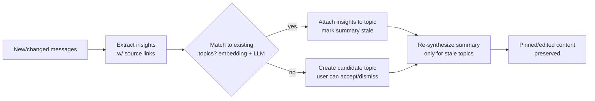

- Topic summaries have `status: fresh | stale`; regeneration is lazy (on view) or batched.
- **User edits and pins take precedence:** regeneration must not overwrite pinned insights or user-edited text; it proposes a diff instead. **[OPEN]** exact merge UX.

#### 6.3.6 Manual curation

Save a message/selection as an insight; edit insight text; pin; dismiss (suppress re-suggestion); attach insight/topic to project; merge/split topics (**[LATER]**).

#### 6.3.7 MVP vs deferred (explicit)

| Capability | MVP | Rationale |
|---|---|---|
| Message-level chunking + embeddings | ✅ | Foundation |
| Hybrid search (FTS + vector, RRF fusion) | ✅ | Strong quality for low complexity |
| LLM reranking of top-N | ⚠️ optional | Add if recall/precision disappoints |
| On-demand cited synthesis | ✅ | Core value |
| Insight extraction + persistent topics (user-triggered, per-query/per-topic) | ✅ lite | Delivers "knowledge independent of conversations" |
| Automatic background topic discovery via clustering (HDBSCAN/BERTopic-like) | ❌ later | Needs data volume + tuning |
| Entity/concept extraction as separate tables | ❌ later (light tags via LLM OK) | |
| Knowledge graph (typed relations, traversal) | ❌ later | Represent via relational tables first; no graph DB |
| Contradiction detection pipeline | ❌ later | Prompt-level in MVP |
| MCP server | ❌ later | |

### 6.4 Module D — Multi-Model Workspace

**Flow:** user enters prompt (optionally system prompt, parameters) → selects N models → backend fans out in parallel → results streamed back per-model → side-by-side cards.

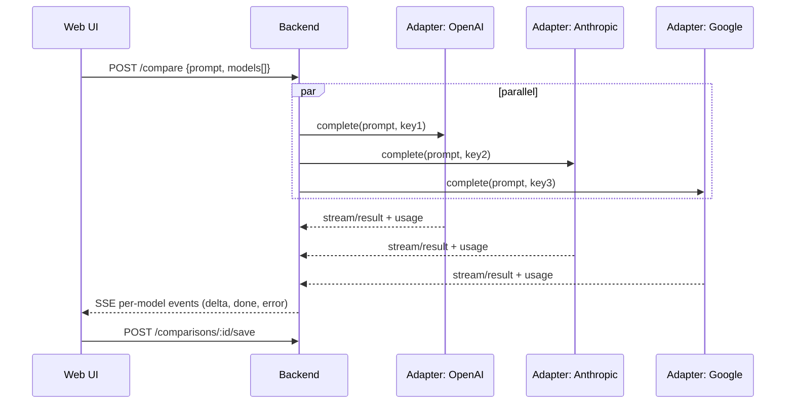

**Requirements**
- BYOK; keys stored server-side encrypted (§14) **or** [OPEN] client-side-only mode where the browser calls providers directly (CORS/provider support varies; reduces server risk but weakens history/persistence).
- Per-model result: text, status, latency (ms; TTFT where streamed), input/output tokens (provider-reported when available, else estimated and labelled so), **estimated cost** computed from a maintained `model_catalog` (price per 1M tokens; user-overridable because prices change). Never hard-code prices into code paths without a versioned catalog.
- Failures isolated per model (one provider error/timeout doesn't fail the comparison).
- Actions: copy, save comparison, "save to knowledge" (creates insight with source link to the stored response), "continue with this model" (creates a first-party conversation; **[LATER]**).
- Model capabilities (context window, vision, tools, streaming, structured output) described in `model_catalog`; UI disables unsupported options per model.
- Saved comparisons and continued chats become first-party conversations in the unified history (provider = API provider, `source = workspace`), so they are indexed by Modules A–C.

**Adapter contract (conceptual)**

```ts
interface ModelProviderAdapter {
  id: string;                                 // "openai" | "anthropic" | "google" | ...
  listModels(key): Promise<ModelInfo[]>;      // or static catalog
  complete(req: UnifiedRequest, key): AsyncIterable<UnifiedChunk>;
  countTokens?(req): number;
  mapError(e): UnifiedError;                  // rate limit, auth, context-length, etc.
}
```

---

## 7. User Experience and Information Architecture

### 7.1 Design principles
Fast navigation (command palette ⌘K), clean hierarchy, search always reachable, **visual separation of original vs. synthesized content**, citations always one click from the claim, AI never changes organization without confirmation, low-friction review.

### 7.2 Navigation (web app sidebar)

```
┌ Search (⌘K) ─────────────────────┐
│ ▸ Inbox  (n pending review)      │   ← new/uncategorized/suggestions
│ ▸ All Chats                      │
│ ▸ Categories  ▾                  │
│ ▸ Projects    ▾                  │
│ ▸ Knowledge                      │   Topics · Insights · Ask
│ ▸ Compare Models                 │
│ ▸ Bookmarks                      │
│ ▸ Import                         │
│ ▸ Settings                       │   Providers & accounts · API keys · Privacy · Export/Delete
└──────────────────────────────────┘
```

**Refinement over the brief:** add **Inbox** (review queue) as the primary entry point for Module B; add **Import** as a first-class page (onboarding critical for historical data).

### 7.3 Information architecture (site map)

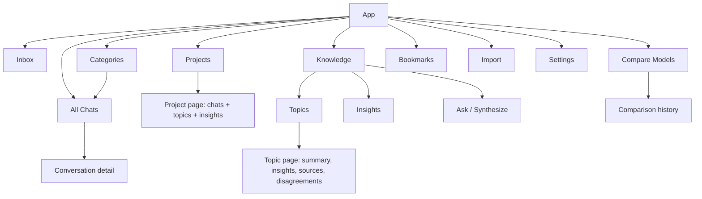

### 7.4 Primary user flows

| Flow | Steps |
|---|---|
| **Onboarding** | Sign up → privacy explainer & consent choices → install extension → connect accounts (label them) → optional export import → first dashboard |
| **Capture & review** | Use ChatGPT normally → extension captures → badge shows "3 new" → open popup/side panel → one-click accept suggestion |
| **Find** | ⌘K or extension search → results (hybrid) grouped by conversation with matching message highlighted → open detail or original |
| **Synthesize** | Knowledge → Ask "Collate everything about X" → retrieval preview (chats included; user can untick) → cited synthesis with agreements/disagreements → "Save as topic" |
| **Curate** | On topic page: pin insight, edit summary, dismiss, assign to project |
| **Compare** | Compare Models → type prompt → pick models → run → compare → save best into Knowledge |
| **Privacy** | Settings → see what's stored, per-feature LLM toggles, export, delete account |

### 7.5 Extension UI surfaces
- **Popup:** status (connected? provider/account detected), pending suggestions, quick search.
- **Side panel (Chrome Side Panel API):** richer review queue, search, and "related past chats/knowledge for this conversation" **[LATER]**.
- **In-page indicator (minimal):** small "captured ✓" badge; no heavy DOM injection into provider pages **[OPEN]**.

### 7.6 Visual direction
Productivity-tool aesthetic (similar in spirit to Linear/Notion/Raycast-like density, not a chat-bubble dashboard): neutral palette, one accent, dense list views, keyboard-first, dark mode. Provider identity via small icons + account color chips. Synthesized content uses a distinct panel treatment and "AI-generated" label.

---

## 8. System Architecture

### 8.1 Principle: modular monolith

One deployable backend (Node/TS) with strict internal module boundaries (ingestion, conversations, organization, search, knowledge, models, auth), a Postgres instance, and a job runner. Modules communicate through typed interfaces/in-process events so any can be extracted later.

### 8.2 High-level architecture

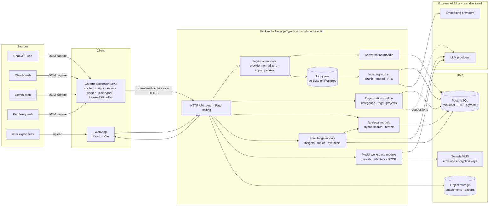

### 8.3 Logical pipeline (maps to brief §5)

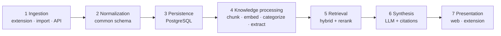

Separation rule: stages communicate only via persisted data / jobs. Re-running indexing or synthesis never requires re-ingestion.

### 8.4 Capture data flow

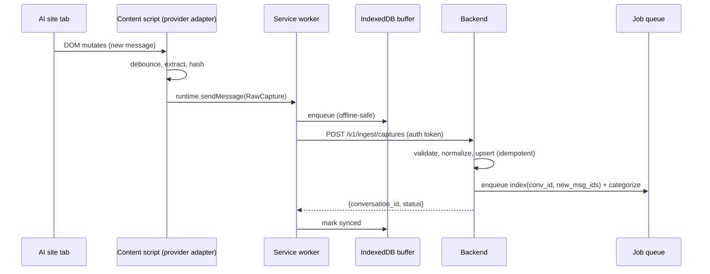

### 8.5 Retrieval + synthesis flow

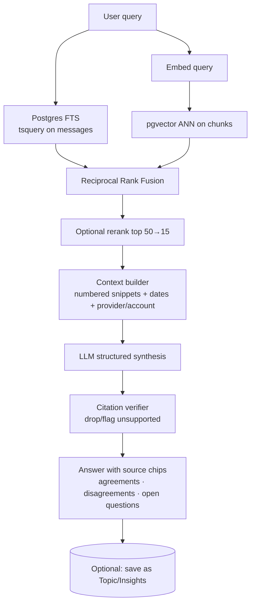

### 8.6 Deployment (MVP)
- **[ASSUMPTION]** Single-region cloud deploy: one Node container (API + worker, same codebase, different entrypoints), managed Postgres with pgvector, S3-compatible object storage, Redis **not** required (pg-boss on Postgres).
- Web app as static assets (CDN). Extension via Chrome Web Store (unlisted/private beta first).
- Local dev: Docker Compose for Postgres; all else runs via Node.

---

## 9. Technology Stack and Justifications

| Layer | Choice | Verdict | Justification / change |
|---|---|---|---|
| Frontend | React + TypeScript + Vite + Tailwind + shadcn/ui | **Accept** | Mature; shared components with extension; shadcn gives owned, customizable primitives |
| Routing/data | TanStack Router/React Router + TanStack Query | Recommend | Cache/invalidations for list-heavy UI |
| Virtualized lists | TanStack Virtual | Recommend | Thousands of conversations/messages |
| Monorepo | pnpm workspaces (+ Turborepo optional) | Recommend | Share `packages/types`, `packages/ui`, `packages/schemas` |
| Extension build | Vite + `@crxjs/vite-plugin` **or** WXT | **[OPEN]** | Evaluate maintenance status/MV3 support at start; WXT is a strong candidate |
| Backend | Node + TypeScript + **Fastify** | **Prefer Fastify over Express** | Schema validation, performance, plugin encapsulation maps to module boundaries |
| Validation | Zod (shared schemas) | Recommend | Same schemas for API, extension payloads, LLM structured outputs |
| ORM/query | Drizzle ORM **or** Kysely (+ raw SQL for FTS/pgvector) | **[OPEN]** | Prisma handles pgvector/FTS awkwardly; prefer SQL-near tools |
| DB | PostgreSQL + pgvector + FTS | **Accept** | One store for relational, keyword, vector → fewer moving parts; RLS available |
| Job queue | **pg-boss** (Postgres-backed) | Recommend | Avoids Redis/infra in MVP |
| Auth | Managed or library-based (Better Auth / Lucia-style / Auth.js) with email+password and OAuth; short-lived access tokens for extension | **[OPEN]** | Avoid hand-rolled crypto; see §14 |
| LLM access | Thin internal `LLMProvider` interface; optionally Vercel AI SDK underneath | Recommend | Provider-interchangeable; structured output |
| Embeddings | Provider-pluggable `EmbeddingProvider`; default hosted model **or** local model | **[OPEN]** | See §12.2 |
| Observability | Pino logs, OpenTelemetry (later), Sentry | Recommend | **Redact message content from logs** |
| Testing | Vitest, Playwright (web), fixture-based adapter tests with saved HTML snapshots | Recommend | Provider DOM-drift regression tests |
| Python service | **Not in MVP** | **Defer** | Justified later only for: local embedding/reranker models, BERTopic/HDBSCAN clustering, NLI contradiction models, heavy document parsing. Introduce as a separate worker behind the same job queue interface when needed |
| Graph DB (Neo4j etc.) | **Not used** | **Defer** | Relational edge tables + recursive CTEs suffice well beyond MVP scale |
| Vector DB (Pinecone etc.) | **Not used** | **Reject for MVP** | pgvector is sufficient for per-user scale (up to hundreds of thousands–low millions of chunks per instance; **[ASSUMPTION]**, benchmark) |

---

## 10. Database Schema Proposal

PostgreSQL. All user-owned tables carry `user_id` and are protected by **Row-Level Security** (defense in depth over app-level checks). UUIDv7 (or ULID) primary keys. Timestamps `timestamptz`.

### 10.1 ER overview

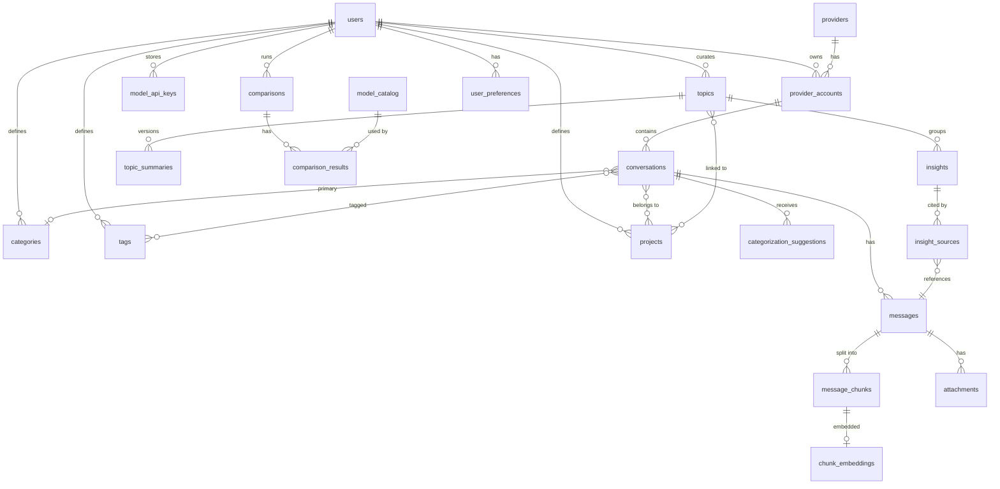

### 10.2 Tables (core columns; not exhaustive)

**Identity & settings**

```sql
users(
  id uuid pk, email citext unique, password_hash text null,   -- null if OAuth-only
  created_at, deleted_at null
)
user_preferences(
  user_id pk fk, llm_features jsonb,            -- per-feature consent/toggles
  default_embedding_model text, privacy jsonb, ui jsonb
)
```

**Providers & accounts**

```sql
providers(                                       -- seeded registry, not user data
  id text pk,                                    -- 'chatgpt','claude','gemini','perplexity'
  display_name text, capabilities jsonb
)
provider_accounts(
  id uuid pk, user_id fk, provider_id fk,
  label text not null,                           -- "ChatGPT – College"
  external_account_hint text null,               -- email/handle/org id if detectable; user-visible
  color text null, created_at, archived_at null,
  unique(user_id, provider_id, external_account_hint)  -- hint may be null
)
```

**Conversations & messages**

```sql
conversations(
  id uuid pk, user_id fk, provider_account_id fk,
  external_id text not null,                     -- provider's conversation id
  title text, url text,
  source text check (source in ('extension','import','api','workspace','manual')),
  created_at_source timestamptz, updated_at_source timestamptz,
  first_captured_at timestamptz, last_synced_at timestamptz,
  message_count int, content_hash text,
  primary_category_id uuid null fk,
  is_bookmarked bool default false, review_status text default 'pending',  -- pending|reviewed|ignored
  raw_metadata jsonb,                            -- provider-specific, never queried by core logic
  unique(provider_account_id, external_id)
)
messages(
  id uuid pk, user_id fk, conversation_id fk,
  ordinal int not null,                          -- position in thread
  external_id text null, parent_external_id text null,  -- branching (regeneration/edit trees)
  role text check (role in ('user','assistant','system','tool')),
  model_name text null,                          -- e.g. as reported by the provider
  content_parts jsonb not null,                  -- structured parts
  content_text text not null,                    -- derived plain text
  content_hash text, created_at_source timestamptz null,
  fts tsvector generated always as (to_tsvector('simple'/'english', content_text)) stored,
  raw_metadata jsonb,
  unique(conversation_id, ordinal)
)
attachments(id, user_id, message_id fk, filename, mime_type, size_bytes, storage_key null, raw_metadata jsonb)
```

> Note: ChatGPT-like products can have **branching message trees** (edits/regenerations). Provide `parent_external_id` and a flag for "active branch" to avoid duplicates; **[OPEN]** whether MVP stores only the active branch (recommended) or all branches.

**Indexing**

```sql
message_chunks(
  id uuid pk, user_id fk, message_id fk, chunk_index int,
  text text, token_count int, content_hash text
)
chunk_embeddings(
  chunk_id fk pk-part, model_id text pk-part,      -- allows multiple embedding models / re-embedding
  embedding vector(N),                             -- N fixed per model; see §12.2
  created_at
)
-- indexes: GIN(messages.fts); HNSW(embedding vector_cosine_ops) per model/dimension partition
```

**Organization**

```sql
categories(id, user_id, name, color, description, is_default bool, archived_at, unique(user_id,name))
tags(id, user_id, name, unique(user_id,name))
conversation_tags(conversation_id, tag_id, source text check (source in ('user','ai_accepted')), primary key(...))
projects(id, user_id, name, description, status, created_at)
conversation_projects(conversation_id, project_id, source, primary key(...))
folders(...)                                       -- [LATER]
categorization_suggestions(
  id, user_id, conversation_id, suggested_category_id null, suggested_new_category_name null,
  suggested_tags text[], suggested_project_id null, confidence real,
  llm_model text, status text check (status in ('pending','accepted','modified','rejected','expired')),
  final_decision jsonb null, created_at, resolved_at
)
```

**Knowledge layer**

```sql
topics(
  id, user_id, name, description, parent_topic_id null,
  origin text check (origin in ('user','ai_suggested','ai_accepted')),
  status text check (status in ('candidate','active','dismissed')),
  summary_status text check (summary_status in ('fresh','stale','none')),
  centroid vector(N) null, created_at, updated_at
)
topic_summaries(                                     -- versioned
  id, topic_id, version int, body_markdown text, structured jsonb,   -- agreements/disagreements/open_questions
  generated_by text, generated_at, is_user_edited bool, is_current bool
)
insights(
  id, user_id, topic_id null,
  kind text check (kind in ('fact','decision','recommendation','idea','definition','question','conclusion')),
  text text not null,
  origin text check (origin in ('ai_extracted','user_saved','user_edited')),
  status text check (status in ('suggested','accepted','dismissed')),
  is_pinned bool, stance text null, created_at, updated_at,
  embedding vector(N) null
)
insight_sources(                                     -- PROVENANCE
  insight_id fk, message_id fk,
  quote text null, quote_start int null, quote_end int null,
  support text check (support in ('supports','contradicts','mentions')) default 'supports',
  primary key(insight_id, message_id)
)
insight_projects / topic_projects (many-to-many)
relations(                                           -- [LATER] graph-like
  id, user_id, from_type, from_id, to_type, to_id,
  relation text check (relation in ('related_to','contradicts','refines','supersedes','part_of')),
  confidence real, origin text
)
entities(id, user_id, name, type, aliases text[])    -- [LATER]
entity_mentions(entity_id, message_id, ...)          -- [LATER]
synthesis_runs(                                      -- audit + reproducibility
  id, user_id, query text, retrieved_message_ids uuid[], llm_model text,
  output jsonb, verification jsonb, created_at
)
```

**Model workspace**

```sql
model_api_keys(
  id, user_id, provider text, label text,
  ciphertext bytea, key_id text,                     -- envelope encryption; never plaintext
  last4 text, created_at, last_used_at, revoked_at
)
model_catalog(                                       -- admin-seeded, versioned
  id text pk, provider text, display_name text,
  context_window int, price_in_per_mtok numeric, price_out_per_mtok numeric,
  capabilities jsonb, effective_from date, deprecated_at null
)
comparisons(id, user_id, prompt text, system_prompt text null, params jsonb, created_at, title null)
comparison_results(
  id, comparison_id, model_id, status, response_text,
  latency_ms int, ttft_ms int null,
  input_tokens int null, output_tokens int null, tokens_estimated bool,
  est_cost_usd numeric null, error jsonb null,
  saved_conversation_id null
)
```

**Operational**

```sql
jobs                                  -- managed by pg-boss
audit_log(id, user_id, action, entity, entity_id, at, ip_hash)     -- no content
extension_sessions(id, user_id, device_label, token_hash, last_seen_at, revoked_at)
```

### 10.3 Schema design notes

- **Provider independence:** core columns are generic; provider-specific details live only in `raw_metadata` and in provider-adapter code.
- **Multiple embedding models:** `chunk_embeddings` keyed by `(chunk_id, model_id)` so models can be swapped/re-embedded without schema change. pgvector requires fixed dimensions per column → use one table/partition per dimension (**[OPEN]**).
- **Why chunk table separate from messages:** long assistant messages exceed good embedding granularity; short messages may be embedded whole (1 chunk). "Message-level indexing" = every chunk maps to exactly one message so citations stay message-level.
- **Soft vs hard delete:** user deletion is a *hard delete* cascade (including embeddings, insights' sources); `deleted_at` only for short grace period on account deletion.
- **RLS:** `USING (user_id = current_setting('app.user_id')::uuid)` on every user table; app connects with a role that cannot bypass RLS.

---

## 11. API and Service Design

REST + JSON (OpenAPI generated from Zod schemas), versioned `/v1`. SSE for streaming (comparison results, synthesis). **[OPEN]** tRPC as an alternative for web-only calls; REST preferred because the extension and future MCP/third-party clients also consume it.

### 11.1 Module boundaries

| Module | Responsibility | Depends on |
|---|---|---|
| `auth` | Signup/login, sessions, extension tokens, user lifecycle | — |
| `providers` | Provider registry, account CRUD | auth |
| `ingestion` | Capture endpoint, import parsing, provider normalizers, idempotent upsert | providers, conversations |
| `conversations` | CRUD/read, filters, detail | — |
| `organization` | Categories, tags, projects, suggestions, decisions | conversations, ai |
| `indexing` | Chunking, embeddings, FTS maintenance (worker) | conversations, ai |
| `search` | Keyword, semantic, hybrid, rerank | indexing |
| `knowledge` | Topics, insights, synthesis, verification | search, ai |
| `models` | Provider adapters, keys, comparisons | auth, ai |
| `ai` (internal lib) | `LLMProvider`, `EmbeddingProvider`, structured output, consent gate, usage log | — |
| `privacy` | Export, deletion, consent records | all |

### 11.2 Endpoint sketch

| Area | Endpoints |
|---|---|
| Auth | `POST /auth/signup`, `/auth/login`, `/auth/logout`, `POST /auth/extension/pair` (device-code flow), `DELETE /auth/sessions/:id` |
| Providers | `GET /providers`, `GET/POST/PATCH/DELETE /accounts` |
| Ingestion | `POST /ingest/captures` (batch, idempotent), `POST /imports` (multipart/presigned upload) → `GET /imports/:id` (status/progress), `GET /ingest/state?provider_account=…` (known `external_id → hash` for delta sync) |
| Conversations | `GET /conversations` (filters, cursor pagination), `GET /conversations/:id`, `PATCH /conversations/:id` (category, bookmark, review status), `DELETE` |
| Organization | CRUD `/categories`, `/tags`, `/projects`; `POST /conversations/:id/tags`; `GET /suggestions?status=pending`; `POST /suggestions/:id/resolve` |
| Search | `GET /search?q=&mode=keyword|semantic|hybrid&filters…` |
| Knowledge | `POST /knowledge/synthesize` (SSE), `CRUD /topics`, `/insights`, `POST /topics/:id/refresh`, `POST /insights/from-message` |
| Models | `GET /models`, `CRUD /model-keys`, `POST /comparisons` (SSE), `GET /comparisons`, `POST /comparisons/:id/save`, `POST /comparisons/:id/results/:rid/to-knowledge` |
| Privacy | `GET /me/export` (async job → download), `DELETE /me`, `GET/PUT /me/consents` |

### 11.3 Cross-cutting API rules
- Idempotency keys / natural keys on ingest.
- Cursor pagination; max payload sizes; per-user rate limits.
- Standard error envelope; no content in error logs.
- Every handler resolves `user_id` from auth context and sets the RLS session variable.
- Extension tokens are scoped (`ingest`, `read`, `suggest`) and cannot manage keys or delete accounts.

### 11.4 Background jobs
`index_message_batch`, `embed_chunks`, `categorize_conversation`, `extract_insights`, `refresh_topic_summary`, `parse_import`, `build_export`, `delete_user_data`.
Jobs are idempotent, retryable, and carry only IDs (never content) in the queue payload.

---

## 12. AI and Knowledge Processing Architecture

### 12.1 Provider-agnostic AI layer

```ts
interface LLMProvider {
  generate<T>(opts: { system, messages, schema?: ZodSchema<T>, model, temperature, maxTokens }): Promise<{ output: T|string, usage }>;
}
interface EmbeddingProvider { embed(texts: string[], opts): Promise<number[][]>; dimensions: number; modelId: string }
interface Reranker { rerank(query: string, docs: string[]): Promise<number[]> }
```
All calls pass through a **consent gate** (is this feature enabled for this user? which provider?) and a **usage logger** (tokens/cost; no content).

**Whose key pays for backend-side AI (categorization, embeddings, synthesis)?** **[OPEN]** Provisional: the *operator's* key for MVP/dev; production options are (a) user-supplied BYOK for all AI features, (b) subscription covering usage. Must be decided before public release (privacy + cost).

### 12.2 Embeddings

| Option | Pros | Cons |
|---|---|---|
| Hosted embedding API (OpenAI/Google/Voyage/Cohere, etc.) | Quality, zero infra | Message content leaves system; cost; vendor dependency |
| Local/self-hosted open model (e.g., BGE/E5/Nomic-class) | Privacy, no per-token cost | Needs CPU/GPU hosting; likely a **Python or ONNX** worker |
| In-browser (WASM/transformers.js) | Privacy, local-first | Heavy on client; not for backend indexing |

**Provisional [ASSUMPTION]:** hosted API behind `EmbeddingProvider` for MVP with explicit consent; keep interface so a local model can replace it. Record `model_id` with each vector. Decide dimension at project start (e.g., 768–1536 range); consider Matryoshka-style truncation for storage savings if the model supports it.

**Chunking:** message = 1 chunk if ≤ ~400–500 tokens; otherwise split on paragraph/code-block boundaries with small overlap. Prepend lightweight context (conversation title, role) to the embedded text but **not** to displayed text. Skip embedding trivial messages (e.g., "thanks"). Embed code messages with the language tag preserved.

### 12.3 Retrieval

1. **Keyword:** Postgres FTS (`websearch_to_tsquery`, ranked via `ts_rank_cd`); consider `pg_trgm` for typo-tolerant title search. Language config: **[OPEN]** (`simple` vs `english`); multilingual users may require `simple` + trigram.
2. **Semantic:** pgvector HNSW cosine ANN on chunks, filtered by user (RLS) + optional metadata filters (provider, account, project, date). Verify filtered-ANN recall (post-filtering can drop results; may need `hnsw.iterative_scan` or partial indexes / over-fetch).
3. **Hybrid:** run both, fuse with **Reciprocal Rank Fusion** (parameter-light, robust). Collapse chunk hits to message and conversation level for display.
4. **Rerank (optional):** cross-encoder or LLM rerank of top ~50 → ~15. **Deferred until measured need.**
5. **Evaluation:** create a small personal "golden set" of queries → expected conversations; track recall@k / MRR when changing models/params. **[MVP-lite]**

### 12.4 Categorization

- Input: title, first user message (truncated), last assistant message (truncated), provider, current user's category/tag/project lists with descriptions, k few-shot examples from user history.
- Output (structured JSON, validated by Zod): `{ category: id|new_name, tags: string[], project: id|null, confidence: 0..1, rationale: short }`.
- Constrain: must choose from existing categories unless proposing a clearly flagged new one.
- Use a small/cheap model tier. Batch on import (with progress and a cost/consent preview).
- **Feedback loop:** accepted/modified decisions stored; later retrieve nearest labeled neighbors (embedding) as few-shot. Track acceptance rate as product metric.

### 12.5 Topic and concept extraction

**MVP-lite (user- or query-driven):**
1. Run synthesis/retrieval for a query or a selected set of conversations.
2. LLM extracts candidate **insights** (structured, with `source_ids` and optional quotes).
3. User (or auto, for pinned workflows) accepts → insights attached to a (new or existing) Topic.

**Later:** periodic clustering of chunk/insight embeddings (HDBSCAN/BERTopic-like; likely Python worker), LLM-named clusters proposed as *candidate topics* for user approval; entity/concept extraction table; recurring concept tracking.

### 12.6 Synthesis

- Prompt includes: user question, numbered snippets (`[S1]…`) with date, provider, account label, conversation title; instructions to cite only supplied IDs, to say "not found in your history" when evidence is insufficient, to report disagreements and uncertainty, and to separate *what the user's AI said* from *established fact* (**the product reports what was discussed, not ground truth**).
- Output schema:

```json
{
  "answer_markdown": "…with [S3][S7] markers…",
  "key_points": [{"text": "...", "source_ids": ["S3","S7"]}],
  "agreements": [{"text":"...", "source_ids":[...]}],
  "disagreements": [{"topic":"...", "positions":[{"summary":"...","source_ids":[...]}]}],
  "open_questions": [{"text":"...", "source_ids":[...]}],
  "coverage_note": "Based on 14 messages across 6 conversations (ChatGPT×3, Claude×2, Gemini×1)"
}
```
- **Verifier:** every `source_id` must exist in the supplied set; claims without sources are removed/flagged; optional entailment check.
- **Large result sets:** map-reduce (summarize per conversation/cluster, then combine), each stage preserving source IDs.
- Store `synthesis_runs` for auditability and "regenerate".

### 12.7 Persistent knowledge update algorithm (MVP-lite)

1. New messages indexed → embeddings exist.
2. For each *topic*, compute similarity between new chunks and topic centroid / its insights; candidates above threshold are queued as "possibly relevant new material" (shown as a **suggestion**, not silently merged).
3. On user acceptance/refresh: extract insights from new material, dedupe against existing insights (embedding similarity + LLM judge), attach, mark summary `stale`.
4. Regenerate summary from *accepted insights only*, preserving pinned/user-edited items.

### 12.8 Evaluation & quality controls
Citation-validity rate (should be ~100% post-verifier), user acceptance rate of suggestions, retrieval golden-set metrics, hallucination spot checks, cost per synthesis.

### 12.9 When a Python service becomes justified
Local embedding/reranking models, clustering/topic modeling, NLI contradiction detection, document parsing at scale. Integrate via the same job-queue contract (worker reads job IDs, reads/writes Postgres directly or via internal API). Not before measured need.

---

## 13. Chrome Extension Architecture

### 13.1 Components (Manifest V3)

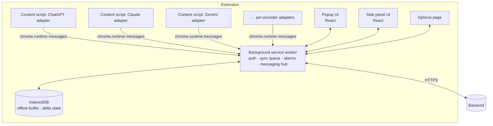

- **Adapters registered per host**, each in its own content-script bundle loaded only on its match patterns (keeps permissions and footprint minimal).
- Shared library `packages/extension-core`: adapter interface, debouncing, hashing, message protocol, retry.
- **Service worker is ephemeral** (MV3 can terminate it): no in-memory state assumptions; queue persistence in IndexedDB; use `chrome.alarms` for retry/sync; wake on messages.
- **React UI** in popup/side panel/options sharing components with web app (`packages/ui`).

### 13.2 Permissions (minimal, justified)

| Permission | Why | Notes |
|---|---|---|
| `host_permissions`/content-script `matches` for each supported AI site only | Capture | Prefer declarative content scripts to broad `<all_urls>`; per-provider opt-in (use **optional host permissions** requested when the user enables a provider) |
| `storage` | Settings, tokens (session-scoped where possible) | |
| `sidePanel` | Side panel UI | Only if side panel shipped |
| `alarms` | Sync retries | |
| Host permission for the app's backend origin | API calls | Single origin |
| **Avoid:** `tabs` (broad), `<all_urls>`, `webRequest`, `cookies`, `history`, `scripting` w/ broad hosts | | `activeTab` where one-shot |

Chrome Web Store review requires a clear single-purpose description and privacy disclosures; document in §14.

### 13.3 Extraction challenges and mitigations

| Challenge | Mitigation |
|---|---|
| **Provider UI/DOM changes** break selectors | Per-provider adapter with **layered strategies** (semantic attributes/ARIA/data-attrs first, structural fallback), **health checks** (does extraction yield ≥1 user+assistant msg?), version-tagged adapters, telemetry-free local failure state + "capture may be broken" UI; fixture-based tests from saved HTML snapshots; fast-release path |
| **Dynamic/streaming content** | MutationObserver + debounce; capture only after streaming completes (stop-generating button gone / idle N ms); re-capture on finalize |
| **Virtualized/lazy-loaded history** (only visible messages in DOM) | Capture what is rendered, merge by message ordinal/id into stored conversation, mark conversation `partial` until full thread seen; optionally guide user to scroll ("Load full conversation") **[LATER: assisted scroll]**; prefer export import for full history |
| **Conversation list (sidebar) virtualized** | Do not rely on sidebar scraping for history discovery in MVP; use export import for backfill; capture conversations as they are opened/used |
| **Branching/edited messages** | Store active branch; keep `parent_external_id` where available |
| **Rich content** (code, images, canvases/artifacts, citations) | Normalize to `content_parts`; store unsupported blocks as raw text/placeholder + `raw_metadata` |
| **Account detection** | Heuristics (account menu/profile element, page-exposed identifiers) — **unreliable and best-effort**; if ambiguous, ask user once to map the browser profile / detected hint → account label; remember in extension storage |
| **Multiple Chrome profiles / incognito** | Extension runs per profile; account mapping per profile; incognito off by default |
| **Shadow DOM / iframes / A/B-tested layouts** | Adapter handles known variants; failures degrade gracefully |
| **Performance impact on host page** | Throttle observers; scope observers to conversation container; no heavy work on main thread |

### 13.4 DOM scraping vs. network-response capture **[OPEN, with legal/ToS caveat]**
Observing the provider's own page network responses (rather than DOM) can yield structured, complete data but relies on **undocumented internal endpoints**, requires broader permissions/world-injection techniques, and is more likely to conflict with provider ToS and Chrome Web Store policy. **MVP default: DOM-based extraction only**, plus official exports for full history. Revisit with legal review. Never automate actions on the user's behalf (no auto-scrolling bots, no automated bulk crawling of their account) in MVP.

### 13.5 Authentication from the extension
Device-pairing / OAuth-style flow via the web app (extension opens web login, receives a scoped token); tokens stored in `chrome.storage.session`/local with expiry and refresh; revocable from web Settings. No provider credentials are ever touched.

### 13.6 Offline buffering
IndexedDB queue of pending captures (content stored only until acknowledged, then purged to hashes); capped size; exponential backoff; user-visible "N pending".

### 13.7 Privacy UX in extension
Per-provider enable toggle; global pause; "capture this conversation only / never capture this one"; list of what's captured; auto-exclude patterns (e.g., private/temporary chat modes — detect where possible and skip). **[MVP]** global pause + per-conversation exclusion.

---

## 14. Privacy and Security

Principle: conversation histories are among the most sensitive data a user has. Security/privacy are **MVP requirements**.

### 14.1 Requirements matrix

| Area | Requirement | Tag |
|---|---|---|
| **Authentication** | Strong password hashing (Argon2id) or passwordless/OAuth; email verification; rate-limited login; optional TOTP/passkeys; short-lived access tokens + rotating refresh tokens; revocable sessions/devices | MVP (passwords/OAuth + verification); MFA/passkeys LATER |
| **Never store provider credentials** | No collection of ChatGPT/Claude/Gemini passwords, cookies, or session tokens. Extension reads only rendered page content; it does not exfiltrate cookies/headers | MVP (absolute) |
| **Transit** | TLS 1.2+ everywhere; HSTS; extension talks only to the configured backend origin; CSP on web app | MVP |
| **At rest** | Managed Postgres with disk encryption; encrypted backups; object storage SSE | MVP |
| **Application-level encryption (field-level)** | Envelope encryption for API keys (**required**); for message content **[OPEN/OPTIONAL]** — note field-level encryption of content breaks server-side FTS/vector search; E2EE is incompatible with server-side AI features | Keys MVP; content OPTIONAL |
| **API key storage (BYOK)** | AES-256-GCM envelope encryption with KMS-held master key; per-key data keys; show only last4; decrypt only in-memory at call time; never log; revocation; scoped per user | MVP |
| **User isolation** | `user_id` on every row; Postgres RLS; automated tests that attempt cross-tenant reads for every endpoint; no shared embeddings/indexes across users; no cross-user caching | MVP |
| **Authorization on retrieval** | Vector/FTS queries always filtered by `user_id` at DB-policy level | MVP |
| **Minimal permissions** | See §13.2 | MVP |
| **Transparent collection** | In-product "What we store / what leaves our system" page; extension shows what is captured; per-provider toggles | MVP |
| **Deletion** | Per-conversation, per-account, per-provider, full-account deletion; cascades to messages, chunks, embeddings, insights' sources, comparisons, keys; backups purged within documented window | MVP |
| **Export** | Full export (JSON + Markdown) of conversations, organization, knowledge with provenance | MVP |
| **Disclosure of third-party AI calls** | Before enabling each AI feature, show: which provider, which data (e.g., "title + excerpts" vs "full messages"), retention policy of that provider (link, not claims). Per-feature toggles; default for categorization = excerpt-only; embeddings require explicit opt-in because they send full message text | MVP |
| **Minimize third-party exposure** | Truncate/excerpt where sufficient; retrieval returns only top-k snippets to synthesis LLM (never full history); optional redaction pass for obvious secrets (API keys, tokens, emails) before sending to external APIs **[LATER, strongly recommended]** | MVP (excerpting); redaction LATER |
| **Secret hygiene in captured content** | Conversations may contain pasted secrets. Offer secret-scanning flag on ingest and user-visible warning/exclusion **[LATER]** | LATER |
| **Logging** | No message content/PII in logs, error trackers, or analytics; job payloads carry IDs only | MVP |
| **Product analytics** | Opt-in; aggregate only; no content | MVP |
| **Prompt-injection awareness** | Captured conversations are *untrusted data*: synthesis prompts must delimit retrieved text as data, no tool execution based on it, MCP/agent features must not act on instructions found in history | MVP (prompt design); critical in Phase 5 |
| **Dependencies / supply chain** | Lockfiles, audit in CI, minimal extension dependencies, reproducible extension build, CSP with no remote code | MVP |
| **Compliance posture** | Provide privacy policy, DPA-ready architecture, data-residency awareness; GDPR-style rights (access, deletion, export) built in | MVP (rights); formal compliance LATER |

### 14.2 Local-first vs. cloud trade-off analysis

| Option | Description | Pros | Cons | Verdict |
|---|---|---|---|---|
| **Cloud-primary** (proposed) | Server Postgres holds data; extension is a thin capture/UI layer | Simplest sync across devices; server-side indexing/jobs; one search path; easiest web app | User must trust the operator; larger breach impact | **MVP default** |
| **Local-first** | Data in browser (IndexedDB/SQLite-WASM/OPFS), optional sync | Strong privacy story; offline | Hard: multi-device sync/conflicts, local vector search, heavy embeddings in-browser, web+extension share storage only via sync, background indexing limits (MV3) | **Defer** |
| **Hybrid: self-hostable** | Same backend deployable by user (Docker) | Privacy-conscious users control data; keeps single architecture | Support burden | **[OPTIONAL]** — design for it now (12-factor config, no cloud-specific lock-in), productize later |
| **E2EE with client-side AI** | Server stores ciphertext only | Maximum privacy | Disables server search/AI; very complex | **Reject for MVP** |

**Decision (provisional):** cloud-primary, architected for self-hosting. Extension IndexedDB used only as a buffer.

### 14.3 Threat model summary

| Threat | Mitigation |
|---|---|
| Cross-user data leak | RLS + tests + per-request user context |
| Stolen extension token | Short expiry, scopes, revocation, device list |
| Malicious/compromised page content (XSS via captured text) | Render messages as sanitized markdown/text; never `innerHTML` raw; CSP |
| Leaked API keys | Envelope encryption, KMS, no logging, last4 UI |
| Third-party LLM retention | Disclosure, excerpt-only default, per-feature consent, provider choice |
| Malicious extension update/supply chain | 2FA on publisher account, minimal deps, signed CI builds |
| Insider access | Least-privilege ops, audit logging, no content in support tooling |
| Prompt injection from stored chats | Data/instruction separation, no autonomous actions |

---

## 15. Competitor Landscape and Differentiation

> **Epistemic note:** This section deliberately avoids factual claims about specific competitors' current features, pricing, or privacy posture, because those must be verified at the time of research and may have changed. Statements are labelled **Validated** (based on the brief itself or general, stable knowledge) vs. **To research**.

### 15.1 Known category and reference points

- **LLMnesia** (named by the requester) and "other AI conversation management tools" exist in a category that includes cross-platform AI history/search, browser-extension capture, semantic search, and (in some cases) MCP/knowledge features. **The requester states that cross-platform history, semantic search, MCP integration and knowledge synthesis must not be assumed novel; this spec adopts that stance.**
- Adjacent categories: general note-taking/PKM tools with AI (e.g., Notion-, Obsidian-, Mem-like), "chat with your data" RAG apps, multi-model chat front-ends/aggregators (e.g., OpenRouter-style routing, "compare models" UIs), and AI providers' own built-in memory/search/project features.
  *(Named as category examples only; their specific current capabilities are **To research**.)*

### 15.2 Competitive research plan **[Required before Phase 3 investment]**

For each of ≥5 competitors, record in a table: supported providers, capture method (extension/export/API), storage location (local/cloud), search type, organization features, synthesis features with citation behavior, multi-model compare, MCP support, pricing, privacy policy claims, review/user complaints. Sources: product sites, store listings, docs, hands-on trials, public reviews. Store in `docs/competitors.md` with dates and URLs.

### 15.3 Overlap vs. potential differentiation

| Capability | Status for this product | Competitive stance |
|---|---|---|
| Cross-provider conversation history | Core (Module A) | **Likely overlaps** existing tools — table stakes (to verify) |
| Multiple accounts per provider with labels | Core | **To research** — may or may not be well supported elsewhere |
| Keyword + semantic search | Core | **Likely overlaps**; quality/UX is the battleground |
| AI categorization | Core (Module B) | May overlap; **differentiator hypothesis:** *user-controlled* review workflow (confirm queue, learning from corrections) rather than opaque auto-sort |
| Project-centric organization (conversations + insights + topics per project) | Core | **Hypothesis:** project as first-class container for knowledge, not just folders of chats |
| Cited, persistent knowledge layer (topics/insights independent of chats, editable/pinnable, incrementally updated) | Core (Module C) | **Hypothesis:** deeper than chat-with-history; needs user validation |
| Disagreement/uncertainty surfacing across providers | Core | **Hypothesis**; novelty unverified |
| Multi-model comparison with save-to-knowledge loop | Module D | Comparison UIs exist; **hypothesis:** integrating comparisons into the same knowledge base is the differentiator |
| MCP server | Phase 5 | **Not novel** (assume competitors have/will have it) |

### 15.4 Differentiation hypotheses to validate (user research, not facts)

1. Users value *project-based* retrieval ("everything for Project Anno") over generic search.
2. Users will tolerate a quick review queue if suggestions are accurate (target: ≥70% accept-as-is — **[ASSUMPTION]**, to validate).
3. Citation-backed synthesis builds more trust than uncited summaries.
4. Seeing disagreement across providers is perceived as valuable, not noisy.
5. Multi-account users (personal/college/work) experience enough fragmentation to adopt a tool.

Validation: 5–10 user interviews + concierge MVP (manual import + search) before deep Module C investment.

---

## 16. Development Roadmap

Dependencies are cumulative: Phase N assumes completion of prior phases unless noted. Durations are rough **[ASSUMPTION]** for a small team/solo builder with AI-assisted development; treat as relative sizing, not commitments.

### Phase 1 — Foundation and Unified History (≈ 5–7 weeks)

**Goals:** Prove capture + unified browsing/search for 2 providers.

**Features**
- Monorepo, CI, lint/test infra, Docker Compose Postgres.
- Auth (email/password or OAuth), user isolation (RLS), settings skeleton.
- Provider registry; accounts CRUD with labels.
- Schema: users, providers, accounts, conversations, messages, attachments(metadata).
- Ingestion API (idempotent), normalizers, **historical import** for 1–2 providers (export parsers).
- Chrome extension MV3 skeleton: pairing/auth, 2 provider adapters (**[ASSUMPTION]** ChatGPT, Claude), offline buffer, popup status.
- Web: dashboard (list, filter by provider/account/date, keyword search via FTS, conversation detail, open-original link).
- Data export + delete (basic).

**Dependencies:** none (foundation).

**Technical components:** Fastify API, Drizzle/Kysely, Zod shared schemas, pg-boss (even if jobs minimal), React app shell, extension build pipeline, adapter test fixtures.

**Acceptance criteria**
- Import an export of ≥1,000 conversations without error; re-import is idempotent (no duplicates).
- Capture new conversation in ChatGPT/Claude within ≤10 s of response completion; appears in dashboard.
- Editing/continuing an existing conversation updates only new messages (verified via DB counts).
- Filter by provider + account + date works; keyword search returns results < 500 ms p95 on 50k messages (**[ASSUMPTION]** target).
- Cross-tenant isolation test suite passes.
- Extension requests only documented permissions.

**Risks:** DOM fragility; export-format changes; account detection unreliability; ToS gray areas (§18).

### Phase 2 — Intelligent Organization (≈ 3–4 weeks)

**Goals:** Make organization nearly effortless but user-controlled.

**Features:** Categories (seeded + custom), tags, projects, bookmarks; LLM suggestions (category, tags, project); Inbox/review queue in web + extension; accept/modify/reject; feedback storage; few-shot personalization; account-level filtering refinements; bulk operations on import; consent UI for LLM use.

**Dependencies:** Phase 1; `ai` module with consent gate; an LLM provider key (operator or BYOK).

**Components:** `LLMProvider` abstraction, structured output + Zod validation, categorization job, suggestions table, extension popup/side-panel review UI.

**Acceptance criteria**
- New conversation yields a pending suggestion within 30 s (when AI enabled).
- User can resolve a suggestion in ≤2 interactions.
- Suggestions never modify conversations without explicit action.
- Rejected/modified decisions persisted and included as few-shot examples; measured acceptance rate visible in a dev dashboard.
- Only excerpt text is sent externally by default; verified by request-logging test.

**Risks:** poor suggestion accuracy with small label sets; cost on bulk import; users feeling nagged (mitigate: batch review, silence option).

### Phase 3 — Semantic Search and Knowledge Layer (≈ 6–8 weeks)

**Goals:** Deliver cross-conversation retrieval and trustworthy cited synthesis with persistent topics.

**Features**
- Chunking + embeddings pipeline (backfill + incremental), model_id tracking.
- Hybrid search (FTS + vector, RRF), filters; message-level hits.
- Ask/Synthesize with streaming, citations chips, agreements/disagreements/open questions; citation verifier.
- Insights: extract/save/edit/pin/dismiss; Topics with persistent summaries (versioned), stale/fresh; link to projects.
- "Related conversations" on conversation detail.
- Evaluation harness (golden queries).

**Dependencies:** Phases 1–2 (data, consent gate, projects). Embedding provider decision.

**Components:** pgvector HNSW, chunker, embedding job, search module, knowledge module, synthesis_runs, verifier, topic UI.

**Acceptance criteria**
- Backfill embeddings for 10k messages with resumable jobs and cost estimate shown before start.
- On golden set: hybrid recall@10 ≥ keyword-only and ≥ semantic-only (**[ASSUMPTION]** relative target).
- 100% of claims in synthesis output carry valid, resolvable source IDs (verifier-enforced); clicking a citation opens the exact message.
- Query "collate everything about X" returns synthesis spanning ≥2 providers when data exists; shows coverage note.
- Conflicting statements across ≥2 conversations (test fixture) appear under `disagreements`.
- Pinned/edited insights survive summary regeneration.
- Query latency: retrieval p95 < 1.5 s; first synthesis token < 5 s (**[ASSUMPTION]**).

**Risks:** hallucinated/overgeneralized synthesis; cost; poor topic quality; filtered-ANN recall; embedding privacy concerns; model/vendor churn.

### Phase 4 — Multi-Model Workspace (≈ 3–5 weeks)

**Goals:** One prompt, many models, comparable results, saved into the system.

**Features:** model-provider adapters (OpenAI, Anthropic, Google first), BYOK key management (encrypted), model catalog (pricing/context/capabilities, user-overridable), parallel streaming execution, side-by-side UI with latency/tokens/estimated cost, copy, save comparison, save-to-knowledge, saved comparisons appear in history; per-model error isolation. *(Continue-with-model **[LATER within phase 4+]**.)*

**Dependencies:** Phase 1 (auth/storage), key encryption infra; Phase 3 for save-to-knowledge.

**Components:** `ModelProviderAdapter`, SSE streaming, KMS envelope encryption, comparison tables.

**Acceptance criteria**
- Run ≥3 models concurrently; one failing/timeouts doesn't affect others.
- Keys never appear in logs/responses (automated test); only last4 shown.
- Latency/token/cost displayed; cost flagged "estimated" and sourced from catalog version.
- Saved comparison reloadable; response saved as insight retains source link to stored response.

**Risks:** API drift across providers; pricing changes; streaming/error normalization; users confused by API vs subscription (onboarding copy).

### Phase 5 — Advanced Knowledge Intelligence (exploratory)

**Prioritization (by value/effort):**

| Item | Value | Effort | Priority |
|---|---|---|---|
| Project-level knowledge aggregation (project dashboards) | High | Low–Med | 1 |
| Automatic topic discovery via clustering → candidate topics | High | Med | 2 |
| Contradiction detection pipeline | High (differentiator) | Med–High | 3 |
| Unresolved-questions tracking | Med | Med | 4 |
| Knowledge evolution timeline | Med | Med | 5 |
| MCP server (read-only search/knowledge tools for external AI clients) | Med–High | Low–Med | 3 (parallel) |
| Topic relationship graph / visualization | Med | High | 6 |

**Acceptance (per item, to be defined at phase start):** measurable precision on labeled fixtures; user-accept rates for suggested topics/relations; MCP: authenticated, scoped, read-only by default, prompt-injection-hardened.

**Risks:** over-engineering; low-precision relations eroding trust; MCP exposing sensitive history to external clients (needs explicit scopes/consent).

### 16.6 Roadmap dependency graph

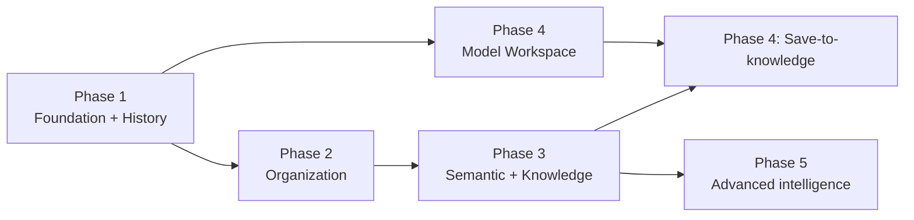

*Note:* Phase 4's core (compare UI) is independent of Phases 2–3 and could be built earlier if validation suggests Module D is the stronger hook.

---

## 17. MVP Scope and Acceptance Criteria

### 17.1 Definition of MVP

**MVP = Phases 1 + 2 + the retrieval/synthesis core of Phase 3** (hybrid search, cited synthesis, insights, persistent topics-lite). Module D (Phase 4) is **post-MVP** but architecture-ready.

**Rationale:** Modules A–C validate the core thesis (unified history → organization → trustworthy knowledge). Module D is separable, relies on a different mechanism (BYOK APIs), and is the most "commodity" feature among competitors (to verify).

> **[OPEN]** If product validation shows multi-model comparison is the stronger acquisition hook, swap Phase 4 earlier.

### 17.2 In / out of MVP

| In MVP | Out of MVP |
|---|---|
| Web app + Chrome extension | Mobile apps, Firefox/Safari extension |
| 2 capture providers (ChatGPT, Claude) + export import (≥1) | Gemini/Perplexity capture hardening **(Phase 1.5)**, other providers |
| Multi-account labels | Automatic account detection guarantees |
| Dashboard, filters, FTS | Folders, advanced saved views |
| AI category/tag/project suggestions + review queue | Auto-apply, fine-tuned classifiers |
| Hybrid search, cited synthesis, insights, topic pages (user-triggered) | Auto-clustering, graph, contradiction pipeline, entity tables |
| Export, deletion, consent UI, encrypted secrets | MFA/passkeys, secret-redaction, E2EE, local-first |
| Single-region cloud deploy; self-host-ready config | Multi-region, teams/sharing |

### 17.3 MVP acceptance criteria (end-to-end)

| # | Criterion |
|---|---|
| 1 | A new user can sign up, install the extension, pair it, label 2 accounts, and see a captured conversation in the dashboard within 10 minutes. |
| 2 | A historical export import completes and is idempotent; counts match source within documented tolerance. |
| 3 | Dashboard filters (provider, account, date, category, tag, project, bookmark) work and compose. |
| 4 | Hybrid search returns relevant message-level hits across providers; opening a hit shows the message in context and links to the original conversation URL. |
| 5 | New conversations receive suggestions; user can accept/modify/reject from extension or web; no change without user action. |
| 6 | "Collate everything about X" produces a cited synthesis; **every claim resolves to a real message**; disagreements shown where fixtures contain conflict. |
| 7 | User can save, edit, pin, dismiss insights and attach them to a project; regeneration preserves pins/edits. |
| 8 | Settings show exactly what data is stored and what is sent to which AI provider; features can be disabled individually. |
| 9 | Full export and full deletion work (verified by DB checks incl. embeddings). |
| 10 | Security: RLS tests pass; no plaintext API keys at rest; no content in logs; extension permissions limited to enabled providers + backend origin. |
| 11 | Reliability: adapter health check surfaces breakage; failed syncs retry offline without data loss. |

### 17.4 MVP success metrics (product validation)
Weekly active capture (conversations/user/week), suggestion acceptance rate, search-to-open rate, synthesis "citation click-through", repeat use of Knowledge, qualitative trust feedback, D7/D30 retention. **[ASSUMPTION]** targets to be set after 5–10 pilot users.

---

## 18. Technical Risks and Constraints

| ID | Risk | Likelihood | Impact | Mitigation |
|---|---|---|---|---|
| R1 | **Provider ToS / legal exposure** of DOM capture or any automated retrieval from provider sites; Chrome Web Store policy compliance (single purpose, data use) | Med | High | Legal review before public launch; DOM capture of user's own visible content only; no automation/crawling; prefer official exports; transparent disclosures; be prepared to disable a provider adapter quickly. *This spec does not assert legality or ToS status for any provider — requires verification.* |
| R2 | DOM drift breaks adapters | High | Med | Layered selectors, health checks, fixtures, quick-release pipeline, graceful degradation, export fallback |
| R3 | Incomplete capture (virtualized lists, partial loads) | High | Med | `partial` status, merging, export backfill, user messaging |
| R4 | Export formats change / undocumented | Med | Med | Versioned parsers, tolerant parsing, sample-based tests, clear error reporting |
| R5 | Account identification unreliable | High | Low–Med | User mapping, explicit labels, never block capture on it |
| R6 | MV3 service-worker lifecycle (termination, no persistent state) | Med | Med | IndexedDB queue, alarms, idempotent messaging |
| R7 | LLM hallucination in synthesis/categorization | Med | High | Structured output, source-ID constraint, verifier, "not found" behavior, UI labeling, user curation |
| R8 | Cost of embeddings/LLM at scale (bulk import) | Med | Med | Cost preview, batching, small models for classification, skip trivial messages, caching, hash-based dedupe |
| R9 | Retrieval quality (esp. conversational/code text) | Med | Med | Hybrid, chunking strategy, rerank option, golden set eval |
| R10 | pgvector filtered-search recall/perf at scale | Low–Med | Med | Benchmark early; partial indexes, iterative scan, over-fetch; later partition by user or add dedicated vector store behind interface |
| R11 | Privacy incident (cross-tenant leak, key leak, third-party retention) | Low | Critical | RLS, tests, envelope encryption, consent, minimal exposure, incident plan |
| R12 | Prompt injection through stored content | Med | Med–High | Treat as untrusted; no tool actions; delimiting; essential for MCP |
| R13 | Scope creep (graph, agents) before core is reliable | High | High | Strict MVP boundary (§17); phase gates |
| R14 | Model/API volatility (pricing, deprecations, limits) | High | Low–Med | Model catalog, adapters, user-overridable pricing, version pins |
| R15 | Dedupe/versioning problems (edited messages, regenerated branches, duplicate imports vs. captures of same conversation) | Med | Med | `(account, external_id)` identity, content hashes, branch policy, merge rules; tests |
| R16 | Multilingual search quality | Med | Low–Med | `simple` FTS config + trigram + multilingual embeddings; test with non-English fixtures |
| R17 | Single-builder bandwidth | Med | Med | Phase gating, shared packages, test automation |

**Constraints:** no password/credential handling; Chrome (MV3) only at start; provider-API pricing/limits outside our control; embedding dimensions fixed per pgvector column; privacy requirements limit use of E2EE with server AI.

---

## 19. Future Possibilities

All **[LATER]/[OPTIONAL]** unless promoted.

- Knowledge graph UI and typed relations; knowledge evolution timelines; unresolved-question tracker; contradiction resolution workflows.
- MCP server exposing scoped, read-only search/knowledge tools to external AI clients (and later write-back of insights).
- Browser support: Firefox/Edge/Safari; mobile share-sheet capture.
- Additional providers (Copilot, Grok, Mistral Le Chat, DeepSeek, local LLM UIs, API-based tools, coding assistants/IDE chat logs).
- Self-hosted distribution (Docker), local-first/offline mode, optional E2EE-with-client-side-AI mode.
- Local embeddings/reranking (Python/ONNX worker), local LLM synthesis for privacy-sensitive users.
- Team/shared workspaces, shared project knowledge, permissions.
- Prompt library & reuse analytics ("which model answered best for coding tasks?"), per-model quality tracking.
- Integrations: Obsidian/Notion export, Zotero-style citation export, Slack/GitHub context.
- Automated redaction/secret detection; retention policies (auto-expire categories).
- Browser "ambient recall": surface related past chats/knowledge while the user types a new prompt on an AI site (side panel).
- "Continue conversation with context" — inject selected knowledge into a new prompt for any provider.

---

## 20. Open Architectural Decisions

Each item lists a **provisional assumption** used in this spec and what input is needed.

| ID | Decision | Provisional assumption | Options / considerations | Needs from you |
|---|---|---|---|---|
| OD1 | **Target launch audience & scale** | Single developer-led product, early adopters, hundreds of users, ≤100k messages per user | Public SaaS vs personal tool vs open-source self-host | Intended audience; is this a personal tool or a product? |
| OD2 | **Cloud-primary vs local-first vs self-host** | Cloud-primary, self-host-ready config | See §14.2 | How sensitive/privacy-driven is the positioning? Willing to require users to trust a hosted backend? |
| OD3 | **Who pays for backend AI (categorization/embeddings/synthesis)** | Operator key during MVP/dev; BYOK or subscription for public | BYOK-only for all AI features is simplest legally/financially but adds onboarding friction | Business model; BYOK for everything? |
| OD4 | **Embedding provider & dimensions** | Hosted API behind interface; fixed dim chosen at start | Local model needs Python/ONNX worker | Privacy tolerance for sending full message text to a hosted embedding API; budget |
| OD5 | **LLM provider(s) for categorization & synthesis** | Pluggable; default a small/cheap tier for classification and a stronger tier for synthesis | Single vendor vs multi | Preferred vendor(s)/budget |
| OD6 | **First capture providers** | ChatGPT + Claude (+ export import); Gemini/Perplexity next | Perplexity has different structure (search-centric, citations) | Which providers matter most to you personally? Which exports do you have for testing? |
| OD7 | **DOM capture vs network-response capture** | DOM only in MVP | Network capture richer but riskier (ToS, permissions, brittleness) | Risk appetite; legal review timing |
| OD8 | **Legal/ToS review & Chrome Web Store distribution** | Private/unlisted beta first; legal review pre-public | Public listing requires compliant privacy disclosures | Distribution plan |
| OD9 | **Auth approach** | Library/managed auth with email+password + Google OAuth; device-pairing for extension | Passkeys, magic links | Preferences; need for SSO? |
| OD10 | **ORM/query layer** | Drizzle or Kysely + raw SQL | Prisma less suited to pgvector/FTS/RLS | Familiarity preference |
| OD11 | **Extension build tooling** | WXT or CRXJS (evaluate at kickoff) | Plain Vite multi-entry config | Preference; check current maintenance |
| OD12 | **Message branch policy** | Store active branch only; keep parent pointers | Store all branches | Importance of regenerated answers/edit history |
| OD13 | **Message revision retention** | Update in place; store content_hash only | Keep revision history | Need for edit-history? |
| OD14 | **Full-text language config** | `simple` + `pg_trgm` for titles | `english` stemming; per-user language | Languages in your conversations |
| OD15 | **Topic creation policy** | User-triggered/accepted topics in MVP; auto-discovery later | Auto-create topics with approval queue | Tolerance for AI-created structure |
| OD16 | **Auto-apply suggestions** | Never auto-apply | Optional threshold-based auto-apply | Desired automation level |
| OD17 | **Insight granularity & dedupe** | Atomic insight with 1+ source messages; embedding+LLM dedupe | Larger "note" units | Preference for how knowledge should look (atomic notes vs summaries) |
| OD18 | **Summary merge UX when user-edited** | Regeneration proposes diff; never overwrites edits | Fork versions | Preference |
| OD19 | **Keys for Module D: server-stored vs client-only** | Server-stored, envelope-encrypted | Browser-only calls (CORS-limited, no server persistence of keys) | Trust model for API keys |
| OD20 | **Module D timing vs knowledge layer** | Phase 4 (after knowledge) | Move earlier as acquisition hook | Which module excites you most? |
| OD21 | **Model catalog maintenance** | Manual, versioned, user-overridable pricing | Fetch from provider listing endpoints / community catalogs | Acceptable staleness |
| OD22 | **Attachment handling** | Metadata only in MVP; blobs later | Capture images/files into object storage | Importance of attachments |
| OD23 | **Redaction of sensitive data before external AI calls** | Excerpting in MVP; automated redaction later | Regex/NER redaction pass | Sensitivity of your conversations |
| OD24 | **Project naming/branding** | "AI Manager" working title | — | Final name |
| OD25 | **Hosting/infra vendor** | Any managed Postgres with pgvector + S3-compatible storage | Supabase / Neon / RDS / self-hosted | Budget, region, preferred vendor |
| OD26 | **Competitor research outcome** | Pending (§15.2) | Could change differentiation emphasis | Willingness to do/allow research before Phase 3 |
| OD27 | **Pilot users & validation plan** | 5–10 pilot users (incl. yourself) | — | Who are they? Timeline? |

---

### Appendix A — Suggested repository layout (for later, **not created now**)

```
apps/
  web/            # React + Vite app
  extension/      # MV3 extension (React UI, adapters, service worker)
  api/            # Fastify modular monolith (API + worker entrypoints)
packages/
  schemas/        # Zod schemas / shared types (conversation, capture, API)
  ui/             # shared React components (shadcn-based)
  provider-adapters/  # ingest normalizers + model adapters (shared interfaces)
  extension-core/ # adapter runtime, messaging, buffer
  ai/             # LLM/Embedding/Reranker interfaces + implementations
docs/
  PROJECT_SPEC.md, competitors.md, adr/
```

### Appendix B — Glossary

| Term | Meaning |
|---|---|
| **Provider** | An AI service (ChatGPT, Claude, …) |
| **Account** | A user's login/identity on a provider, user-labelled |
| **Capture** | A normalized snapshot of a conversation sent by the extension |
| **Chunk** | A sub-message text segment used for embeddings |
| **Insight** | Atomic, source-linked statement extracted/saved by user or AI |
| **Topic** | Named subject grouping insights with a versioned summary |
| **Provenance** | The traceable link from knowledge back to source messages |
| **BYOK** | Bring Your Own (API) Key |
| **RRF** | Reciprocal Rank Fusion, a rank-merging method for hybrid search |
| **RLS** | PostgreSQL Row-Level Security |

### Appendix C — Guiding rules for implementation with Claude Code

1. Implement phase by phase; do not start a later phase's components early.
2. Every provider integration lives behind an adapter interface with fixture-based tests.
3. No synthesized statement is rendered without verified source IDs.
4. Add RLS and cross-tenant tests with the first table, not later.
5. No message content in logs, queues, or analytics.
6. Record all provisional assumptions as ADRs when they are confirmed or changed.
